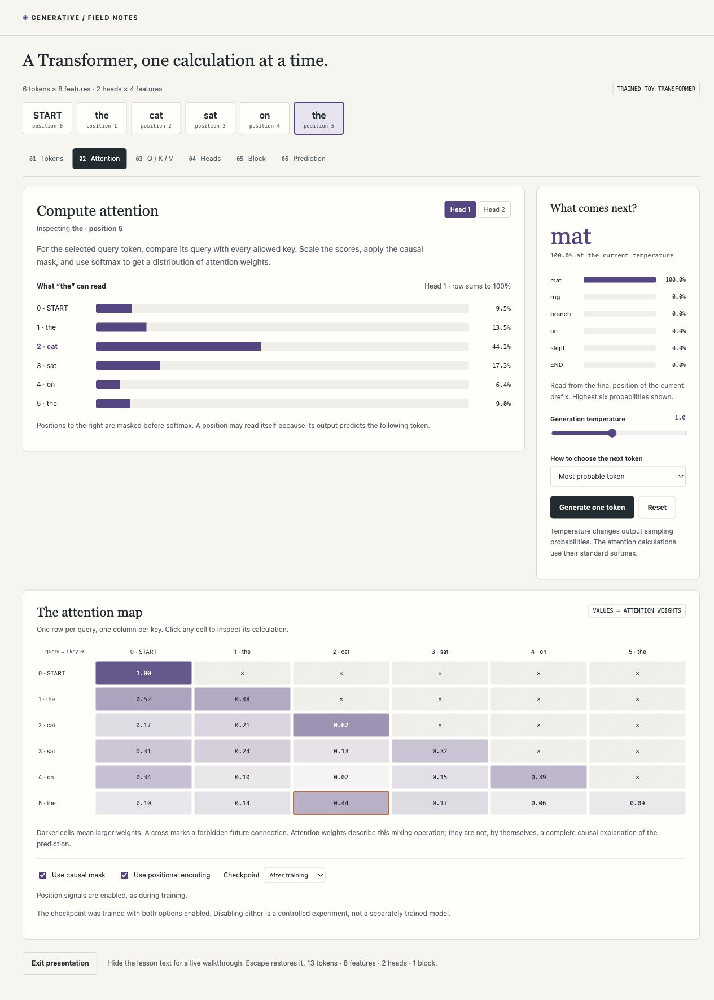

# Transformers — a visual field guide

An interactive introduction to Transformers, using **“the cat sat on the …”** as a running example. It follows tokens through embeddings, positional signals, attention, Q/K/V, multiple heads, a full decoder block, and next-token prediction. The original encoder–decoder architecture is explained separately and cites [Attention Is All You Need](https://arxiv.org/abs/1706.03762).



## Open locally

```sh
python3 -m http.server 8000
```

Visit [http://localhost:8000](http://localhost:8000). A static HTTP server is necessary because the browser uses JavaScript modules and fetches model weights. No package installation, network service, GPU, or API key is needed to use the website. Stop the server with Ctrl+C.

## What to try

1. Select “the cat sat on the …”, then compare the dog and bird examples. The suffix is the same, but the learned prediction changes with the animal.
2. Click a token to choose its query position. Switch between the two attention heads.
3. Click an attention-matrix cell to inspect the query, key, dot product, scale, probability, and weighted value contribution.
4. Step through Tokens, Attention, Q/K/V, Heads, Block, and Prediction.
5. Disable the causal mask to inspect future-information leakage at earlier training positions. Try disabling positional encodings, or switching to the actual before-training checkpoint.
6. Generate one token at a time. Choose greedy decoding or sampling, and change the output temperature.
7. Open the equations or the original-architecture section. Presentation view hides the lesson text; Escape restores it.

## The model is real and deliberately small

The checkpoint is a **single post-normalization causal decoder block** with 8 features, 2 attention heads of width 4, a 16-feature ReLU feed-forward hidden layer, and a 13-token vocabulary. It was trained on exactly six synthetic sentences listed in `model.json`. It does not implement an encoder or cross-attention and is not a general language model.

The numerical browser implementation runs the complete forward pass. Attention weights and predictions are computed from the supplied learned parameters, rather than scripted for the selected sentence. The training reference implements explicit NumPy backpropagation and Adam. The supplied initial checkpoint and recorded loss curve come from that same training run.

Tokens are whole words in this toy tokenizer, plus START and END. Real text tokenizers often use subwords. The interface limits the context to eight tokens including START; the training sequences have seven input positions. Disabling the mask or positional encodings is a counterfactual experiment: neither option retrains the model. Output temperature affects the vocabulary distribution, not attention’s normalization.

A head’s weights describe its value-mixing operation, not a complete causal explanation of the model. Head roles are not preassigned. Without positional encodings, **unmasked** self-attention is permutation equivariant; a causal mask still restricts accessible context, so a causal decoder without position signals is not completely order-blind.

The architecture diagrams describe the classic encoder–decoder Transformer. They do not run a translation model. Our block follows the original post-LN convention and uses sinusoidal encodings; dropout is omitted so the forward pass is deterministic. The output readout is independently learned, rather than tied to the token embedding matrix.

## Verify and reproduce

```sh
npm test
npm run check:math
```

The eight model checks cover NumPy/JavaScript parity at every output position, causal masking, future-token noninterference, permutation equivariance in the appropriate setting, learned noun-dependent completion, shifted targets, dimensions, and stable softmax/token validation.

To reproduce training, install NumPy in your chosen Python environment and run:

```sh
python3 train.py --check-grad
```

This checks derivatives for ten parameter groups and trains for 1600 steps by default, then rewrites `model.json` and `parity.json`. Run `npm test` afterward. The seed and dataset are fixed. Floating-point results can vary slightly across NumPy versions and platforms.

The provided run reduces cross-entropy from approximately 2.703 to 0.256 nats per token. The loss cannot reach zero because identical prefixes have multiple valid next tokens in the dataset. The browser’s training table shows one chosen dataset sentence; the recorded curve averages the full six-sentence batch.

## Edit equations

Equations are authored as LaTeX in `math.json`. Run `node render-math.mjs` after changing them; `node render-math.mjs --check` validates that the committed HTML is up to date. KaTeX 0.19.1 is bundled with its license. Published pages use pre-rendered HTML/MathML and local fonts, so rendering does not depend on a CDN or browser-side math library.

## Files

- `index.html`, `styles.css`: lesson, original diagrams, responsive layout, accessible controls.
- `app.mjs`: synchronized model explorer, prediction controls, and training visualization.
- `model.mjs`: readable, dependency-free Transformer forward pass.
- `model.json`: trained and initial weights, dimensions, vocabulary, dataset, and training history.
- `train.py`: independent NumPy implementation with explicit backpropagation, gradient checks, and training.
- `parity.json`: reference logits for browser/reference verification.
- `tests/model.test.mjs`: meaningful numerical and behavioral checks.
- `math.json`, `render-math.mjs`, `vendor/katex/`: LaTeX sources and pre-rendering tools/assets.

## GitHub Pages

The project is static and ready for GitHub Pages. Create an empty GitHub repository named `transformers-explained`, add it as `origin`, and push the local `main` branch. In **Settings → Pages**, choose **Deploy from a branch → main → /(root)**. `.nojekyll` serves the files directly. All assets use relative paths, so a project URL works without a build step.

This initial delivery is a local repository. No remote repository or public deployment is created by the local setup.

## Reference

Vaswani, A., Shazeer, N., Parmar, N., Uszkoreit, J., Jones, L., Gomez, A. N., Kaiser, Ł., and Polosukhin, I. (2017). **Attention Is All You Need.** [Original paper](https://arxiv.org/abs/1706.03762).

This is an independent educational implementation and does not reproduce the original translation experiments or their results.
